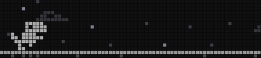
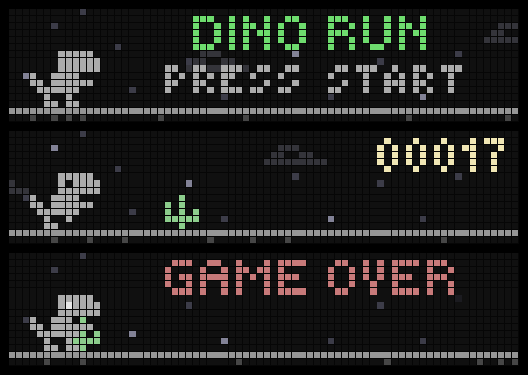

# BUSY Bar — Dino Run



An endless runner for the BUSY Bar's 72×16 front display, in the spirit of the
T-rex game from a browser's offline page. Jump the cacti, duck the birds, and
see how far you get. Everything that moves is played natively by the bar at
**62.5 fps** (one step per 16 ms display refresh), so the scrolling ground,
the obstacles and the jumps are perfectly smooth.



*Above: screenshots from a real bar. Top: a gameplay animation rendered from
the game's own sprites and physics.*

- **Obstacles:** single, double and triple cacti (small and large) and
  pterodactyls at three heights. Low ones you jump, middle ones you duck
  under, high ones you just run beneath. Don't jump into them.
- **Speed:** five steps, from 62.5 to 125 px/s. Groups and birds unlock as
  you go. Every obstacle was checked at build time, at every speed, to have
  a fair jump window.
- **Score:** about 9 points per second at the start, like the original. It
  flashes at every 100 with a chime. Your best score is saved on the bar.
- **Look:** dark mode on LEDs. Grey dino, pale-green cacti, drifting clouds
  and twinkling stars. On a crash everything freezes on the hit frame.

## Controls

| Input | Action |
|-------|--------|
| **Start** | Jump. Also starts a game and retries after game over. |
| **OK** (hold) | Duck. |
| **Back** | Exit. |

A jump pressed just before landing still counts.

## Settings

On the bar, go to **Apps → Dino Run → Setup**:

| Setting | Options |
|---------|---------|
| **Sound** | On (default) / Off. Jump, score and crash sounds. |

## Install on any BUSY Bar

**Archive:** download `community.dino_run-<version>.tgz` from this repo's
[Releases](../../releases/latest), or build it with `python3 build_package.py`
(it lands in `dist/`). Upload it in the bar's web interface with **Upload app**,
or install it over HTTP:

```bash
curl -X POST -H 'Content-Type: application/octet-stream' --data-binary @community.dino_run-1.0.0.tgz http://<bar-ip>/api/apps/stage
```

That returns an `install_key`. Pass it to:

```bash
curl -X POST "http://<bar-ip>/api/apps/install?install_key=<key>"
```

The bar needs firmware with HTTP API **27.14.0 or newer**. The game relies on
switching animation sections on a live element, which older firmware doesn't
do. No internet connection is needed.

**Dev install** over USB (default address `10.0.4.20`) uploads the files directly:

```bash
./install_dino_run.sh
```

For Wi-Fi, set the HTTP-API password: `BAR_TOKEN=<password> ./install_dino_run.sh <bar-ip>`.
Then on the bar, go to **mode switch → Apps → Dino Run → Start**. The
installer closes the app first if it's open, because the bar won't replace
files of a running app.

## Layout

```
community.dino_run/
├── anims/     sky, ground, obstacles, dino (.anim, played natively)
├── appmeta/   manifest.json, settings.json (Setup), icons
├── scripts/   main.js (generated: edit main.src.js)
└── sounds/    jump, score, hit (.snd, raw 16-bit 44.1 kHz mono)
sprites.py           # pixel art + palette
main.src.js          # game logic; build_assets.py injects the data into main.js
build_assets.py      # anims, sounds, icons, obstacle fairness check, main.js
preview_sprites.py   # scaled sprite sheet -> preview/sprites.png
build_package.py     # installable archive -> dist/community.dino_run-<version>.tgz
install_dino_run.sh  # curl installer (dev)
test/stage_install.sh  # clean install of the .tgz the official way + screen grabs
test/shots.py          # screen grabs -> preview/device.png
test/preview_gif.py    # preview/gameplay.gif from the sprites
```

Building needs Python 3.10+ with Pillow, numpy and colorlog, plus the BUSY Bar
firmware checkout for its `.anim` encoder (`scripts/seq2anim.py`). Set `BSB_FW`
if it isn't at `../busybar-fw-jerryscript`.

```bash
python3 build_assets.py && ./install_dino_run.sh
```

## How it works

A draw request from an app's JavaScript costs about 40 ms on the bar, so
moving sprites from JS tops out at 10–20 fps. Instead, **nothing on screen is
moved by JS**:

- **Layers:** sky, ground, each obstacle and the dino are separate `animation`
  elements. The firmware steps them itself, once per display refresh.
- **Obstacles:** each one is an animation of itself crossing the screen at
  the current speed, started as a new element when it spawns.
- **Jumps:** a section of the dino animation. Run or duck is queued after it
  with `await_previous_end`, so the landing is seamless.
- **Speed-ups:** the 210 px ground texture is a whole number of frames at
  every speed, and every speed's section starts at the same offset. The ground
  switches speed on its loop boundary without a seam.
- **Collisions:** JS predicts where everything is from the clock and checks
  pixel masks, a few frames ahead. On a hit it switches every layer to a
  one-frame "still" section at that exact position, which freezes the scene.
- **Frame rate:** the files say 76 fps on purpose. On fw 27.14 that locks to
  exactly one frame per 16 ms refresh; 60 fps would give 20 ms.

## Tuning

`OBST_LAG` in `main.src.js` shifts where the game thinks obstacles are
(higher means collisions happen later). 64 ms felt right on the bar.

## Credits

Inspired by the T-rex runner on the Chrome browser's offline page. Original
pixel art, sounds and code. Not affiliated with or endorsed by Google.
